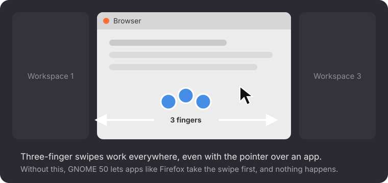

<p align="center"></p>

<h1 align="center">Gestures Everywhere</h1>

<p align="center">Makes GNOME's three-finger touchpad gestures work while the pointer is over an app,<br>
and while a menu is open, not only over the empty desktop.</p>

<p align="center"></p>

## The problem

On GNOME 50, swiping with three fingers to switch workspaces or open the overview only
works when the pointer is over the desktop. With the pointer over an app such as Firefox,
nothing happens, and you have to move the pointer off the window first.

The same happens with a menu open: open Quick Settings (top right), the calendar or an app
menu, and three-finger swipes do nothing until you close it.

## Why it happens

GNOME's workspace and overview gestures ask to see touchpad swipes *before* the app under
the pointer does. In GNOME 50, the touchpad side of those gestures listens at the wrong
point: the swipe goes to the app first. Firefox takes three-finger swipes for itself, so
the system gesture never fires.

While a menu is open, it holds all input and GNOME pauses its gestures on purpose.

This extension hooks GNOME's own two gesture handlers back in where they were meant to be,
so they see every swipe first. And when a three-finger swipe starts on an open menu, the menu
closes and the same swipe carries on as the gesture, so one swipe both closes Quick Settings
and switches desktop (or opens the overview). Your gesture settings and two-finger scrolling are not
touched, and disabling the extension puts everything back exactly as it was.

## Install

Needs GNOME Shell 50.

```bash
git clone https://github.com/aimanelahssini/gnome-gestures-everywhere
cd gnome-gestures-everywhere
./install.sh
```

Log out and back in once so GNOME loads it.

## Uninstall

```bash
gnome-extensions disable gestures-everywhere@aimanelahssini
rm -rf ~/.local/share/gnome-shell/extensions/gestures-everywhere@aimanelahssini
```

## License

MIT
